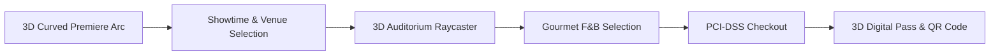

<div align="center">

# 🎬 CINEORA 3D
### Next-Gen Interactive 3D Cinema Experience & Ticket Booking Platform

[](https://www.khronos.org/webgl/)
[](https://threejs.org/)
[](https://docs.pmnd.rs/react-three-fiber)
[](https://huggingface.co/spaces/nvidia/simready-central)
[](https://nextjs.org/)

<p align="center">
  <b>A physically accurate, real-time 3D cinematic auditorium simulator and movie ticket reservation system.</b><br>
  Explore multi-tier architectural auditoriums, stream live 4K movie trailers directly onto curved Cinemascope screens with real-time auditorium light spill, and pick seats with interactive 3D raycasting.
</p>

```
  ┌────────────────────────────────────────────────────────────────────────┐
  │                           CINEMASCOPE 2.39:1 SCREEN                    │
  │                  ▲▲▲▲▲▲ [4K LIVE TRAILER PROJECTION] ▲▲▲▲▲▲            │
  │                         ░░░░░░░░░░░░░░░░░░░░░░░░░                      │
  │  [STAGE] ══════════════════════════════════════════════════════ [STAGE]│
  │                                                                        │
  │    Row A-C:  ████████  Classic Risers (Front Stalls)   ████████        │
  │    Row D-H:  ████████  Prime Sweet-Spot (Center Slope) ████████        │
  │    Row I-J:  ████████  Royal Recliners (Daybed Loungers)               │
  │                                                                        │
  │  ═══════════════════════ BALCONY MEZZANINE ══════════════════════════  │
  │    Row K-N:  ████████  Balcony Mezzanine (Rows K-N)    ████████        │
  │    Row P:    ████████  VIP Private Box Lounge          ████████        │
  │                                                                        │
  │  [BOOTH] ░░░░░░░░  Volumetric Light Beam & Dust Motes ░░░░░░░  [BOOTH] │
  └────────────────────────────────────────────────────────────────────────┘
```

</div>

---

## 🌟 Interactive 3D Features

### 1. 3D Panoramic Hero Arc
- **3D Curved Amphitheater Layout**: Posters arranged in a mathematical circular arc (`x = R·sin θ`, `z = R·(cos θ - 1)`) so all upcoming movies face the viewer without occluding foreground elements.
- **Organic Floating Motion**: Each 3D billboard exhibits subtle harmonic breathing oscillations (`Math.sin(t * 1.8 + i) * 0.09`) to keep the canvas alive.
- **Interactive Cursor Parallax**: Smooth dynamic camera tilt and translation responsive to mouse movement.
- **Swirling 3D Bokeh Motes**: Ambient golden particles orbiting the panoramic stage in 3D space.
- **Auto-Pan Slideshow**: Automatically glides to the next premiere every 7.5 seconds when idle.

### 2. Physical 3D Cinema Hall Simulator
- **True Stepped Stadium Risers**: 10 stepped stalls risers (Rows A to J) with authentic slope angles and LED step guide runners.
- **Cantilevered Balcony Mezzanine**: Elevated structural balcony (Rows K to P) positioned at `z = 24.5, y = 7.1` with a 3-part angled wood fascia and illuminated frosted glass safety railing.
- **Curved 2.39:1 Cinemascope Screen**: Cylindrical curved screen mesh (`radius = 48, arc = 0.68 rad`) for distortion-free anamorphic projection.
- **Live Video Texture Projection**: Streams official HD trailers directly onto the 3D screen canvas with interactive Play, Pause, and Mute controls.
- **Dynamic Auditorium Light Spill**: Real-time spotlight and ambient spill bounce that modulates in intensity and color temperature in sync with the projected trailer frames.
- **Volumetric Projector Light Beam**: Angled volumetric projection cone extending from the rear projection booth (`y = 14.8, z = 32.0`) to the screen with animated 24fps light flicker and 80 suspended atmospheric dust particles.

### 3. Precision 3D Raycasting Seat Selector
- **Interactive Raycasting**: Instant hover tooltips displaying row, seat number, tier, and pricing.
- **4 Luxury Seat Tiers**:
  - 🛋️ **Royal Recliner / Daybed** (Gold `#f59e0b`): Motorized luxury leather loungers with swivel food trays.
  - 👑 **Balcony Mezzanine** (Purple `#a855f7`): Elevated VIP vantage point overlooking the entire auditorium.
  - ⭐ **Prime Sweet-Spot** (Sky Blue `#38bdf8`): Acoustically calibrated center sweet-spot rows.
  - 💺 **Classic Riser** (Slate `#64748b`): Premium ergonomic stadium seats.
- **Seat-POV Camera**: Click any seat to instantly fly the camera directly into that seat's eye-line, previewing the exact viewing angle of the screen before confirming booking.

---

## 🎨 NVIDIA SimReady™ PBR Material Architecture

All architectural and interior meshes follow **NVIDIA SimReady** physical material standards for realistic specular reflections, roughness attenuation, and light scattering:

| Material Component | SimReady Preset | Base Color | Roughness | Metallic | Transmission | Notes |
| :--- | :--- | :--- | :---: | :---: | :---: | :--- |
| **Acoustic Ribs & Walls** | Architectural Oak | `#4a2c11` (Wood Grain) | `0.58` | `0.08` | `0.00` | Staggered vertical diffusers absorbing echo |
| **VIP Leather Recliners** | Napa Leather | `#11131f` / `#854d0e` | `0.42` | `0.05` | `0.00` | Supple leather grain with specular sheen |
| **Cinemascope Screen** | High-Gain Micro-Perf | `#0a0d18` / Video Canvas | `0.22` | `0.02` | `0.00` | 2.39:1 aspect ratio curved projection surface |
| **Volumetric Beam** | Atmospheric Gas | `#bae6fd` (Cool Sky) | `0.00` | `0.00` | `0.95` | Additive blending with animated light flicker |
| **Balcony Glass Railing** | Frosted Acrylic Glass | `#e2e8f0` (Ice White) | `0.10` | `0.05` | `0.85` | Illuminated safety edge with emissive runner |
| **Aisle Step Runners** | LED Luminescence | `#f59e0b` / `#a855f7` | `0.15` | `0.90` | `0.00` | Nighttime navigation pathway guide lights |

---

## 🎥 3D Camera Navigation & Viewpoints

The cinema simulator includes camera position presets with smooth GSAP cubic-bezier transitions:

```
[Overview] ───► [Sleeper Beds] ───► [Balcony View] ───► [From Stage] ───► [Bird's Eye] ───► [360° Free Orbit]
```

- **Overview View** (`[0, 14, 27]`): Complete perspective of the hall, stalls, balcony, and screen.
- **Balcony View** (`[0, 12.5, 26]`): Elevated viewpoint from the center mezzanine looking down at the screen.
- **From Stage View** (`[0, 2.5, -13.5]`): Actor/performer perspective looking out at the 400 seated audience.
- **Balcony Left / Right Box** (`[-14, 11, 22]` / `[14, 11, 22]`): Angled VIP box views.
- **Bird's Eye View** (`[0, 26, 6]`): Top-down tactical layout for easy multi-seat group picking.
- **360° Free Orbit**: Unrestricted orbit controls with clamped collision boundaries inside the auditorium walls.

---

## 🍿 End-to-End Booking Journey



1. **Movie Selection**: Browse multi-lingual blockbusters (Hindi, Marathi, Tamil, Telugu, Kannada, Malayalam).
2. **Showtime & Format**: Choose IMAX Laser, Dolby Atmos 128ch, or VIP Boutique suites.
3. **3D Seat Selection**: Inspect real-time 3D seat availability, view screen from chosen seat, and reserve.
4. **F&B Add-ons**: Fresh buttery popcorn, loaded nachos, chilled beverages, and VIP gourmet combos.
5. **Instant Confirmation**: Digital e-ticket with authentic barcode, QR code, and booking reference.

---

## 🚀 Quick Start

### Prerequisites
- Node.js 18.0 or higher
- npm or pnpm

### Installation

```bash
# Clone the repository
git clone https://github.com/Aayu126/CINEORA_3D-TicketBooking-plateform.git

# Enter project directory
cd CINEORA_3D-TicketBooking-plateform

# Install dependencies
npm install

# Run the development server
npm run dev
```

Visit **[http://localhost:3000](http://localhost:3000)** in your browser.

### Production Build

```bash
# Build optimized production bundle
npm run build

# Start production server
npm start
```

### Vercel Deployment
Ready for 1-click Vercel deployment:
```bash
npx vercel
```

---

<div align="center">
  <sub>CINEORA 3D · Engineered with precision for cinema enthusiasts worldwide.</sub>
</div>
